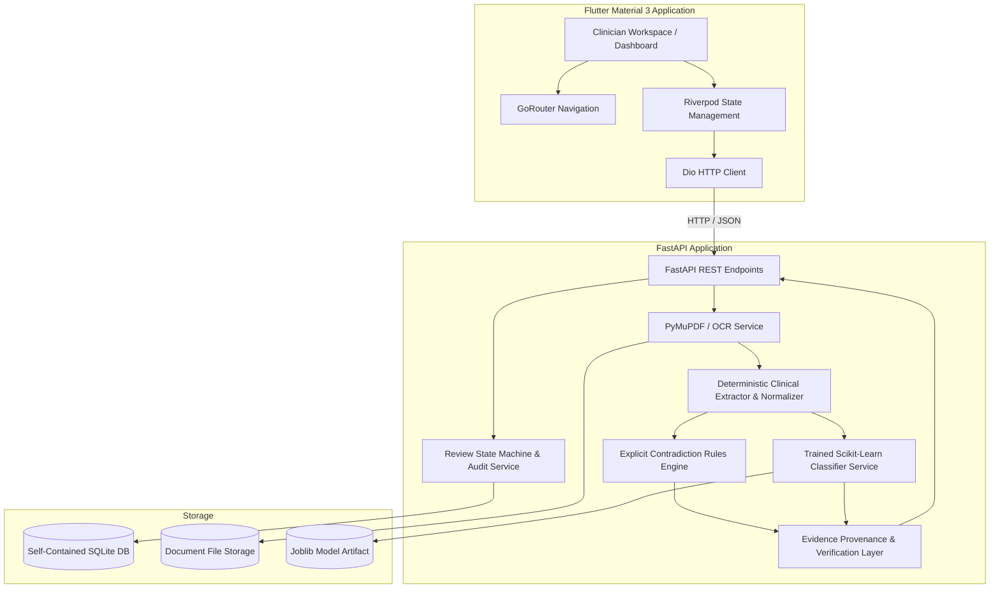
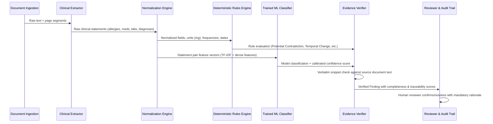

# RecordGuard AI — Technical Architecture (PS-11R3)

RecordGuard AI is a clinician-facing healthcare record reconciliation and contradiction detection system. It extracts clinical statements across multi-provider medical encounters, detects potential discrepancies, provides verifiable provenance from original source documents, evaluates evidence completeness and confidence, and guides an authorized reviewer through human verification with a persistent audit trail.

---

## 1. System High-Level Architecture

---

## 2. Hybrid AI & Decision Pipeline

RecordGuard AI explicitly rejects opaque black-box "guesses" in clinical informatics. It uses a 7-stage hybrid pipeline:

### Stage 1: Document Ingestion & Page Provenance
- Uses **PyMuPDF** (`pymupdf`) to extract text page-by-page.
- Preserves exact page numbers, line boundaries, and file content SHA-256 hashes.
- Fallback: Gracefully invokes Tesseract OCR for scanned image pages if the engine binary is installed, and explicitly notes unreadability if OCR is unavailable without simulating text.

### Stage 2: Deterministic Extraction
- Regex lexicons and dictionary parsing for:
  - Allergies: Positive mentions ("penicillin allergy") vs. explicit negation ("no known drug allergies", "NKDA").
  - Medications: Drug name, dose, unit, frequency, route, and active vs. discontinued status.
  - Diagnoses: Positive assessments vs. denied/ruled-out conditions.
  - Lab results: Test names, numerical values, units, and collection dates.

### Stage 3: Normalization Engine
- **Units**: Standardizes doses (`50 mcg` ➔ `0.05 mg`, `0.5 g` ➔ `500 mg`) and laboratory units (glucose `mmol/L` ➔ `mg/dL`).
- **Frequencies**: Normalizes Latin and informal abbreviations (`BID`, `b.i.d.`, `2x daily` ➔ `twice daily`; `QD`, `every morning` ➔ `once daily`).
- **Brand/Generic**: Maps brand names (`Glucophage` ➔ `Metformin`, `Synthroid` ➔ `Levothyroxine`).
- **Dates**: Parses clinical dates and computes chronological deltas ($\Delta t$ days).

### Stage 4: Deterministic Contradiction Rules
- **Allergy Conflict**: Direct contradiction between presence and explicit negation triggers `POTENTIAL_CONTRADICTION` with `PRIORITY_REVIEW`.
- **Temporal Change**: Active medication in record A followed by documented discontinuation in record B with $\Delta t > 0$ triggers `TEMPORAL_CHANGE` with `STANDARD_REVIEW` (recognizing therapeutic titration over time).
- **Serial Laboratory Tracking**: Differing lab values across distinct dates represent physiologic variation over time, not record corruption.
- **Omission Handling**: An unmentioned allergy section in a transfer note triggers `INSUFFICIENT_EVIDENCE` ("Omission is not proof of absence").

### Stage 5: Trained ML Classifier
- Scikit-Learn pipeline trained on 3,200 synthetic paired examples.
- Combines TF-IDF word and character n-grams with engineered clinical dense features.
- Provides independent model confidence and classification to support the review without overwriting deterministic safety checks.

### Stage 6: Evidence Provenance & Verification
- Prior to saving a finding, the backend executes a verbatim substring search in the extracted document text.
- Calculates an objective **Traceability Score** and **Completeness Score**.

### Stage 7: Human Verification & Audit State Machine
- Requires authorized clinician rationale for any status transition (`CONFIRMED`, `RESOLVED`, `UNRESOLVED`, `REQUESTED_DOCS`).
- Preserves full status transition logs, actor timestamps, and clinical notes in persistent SQLite tables.
